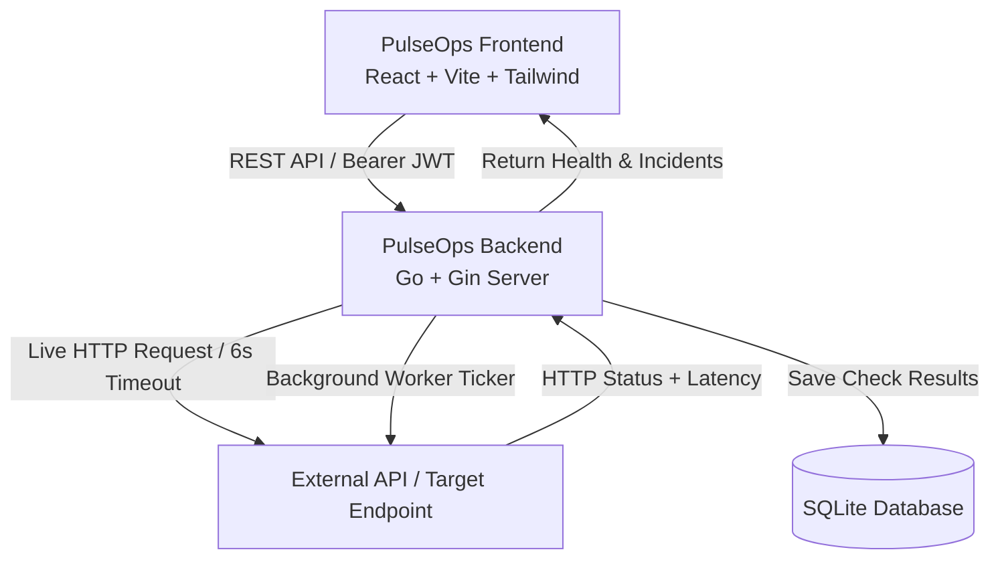

# PulseOps - API & Cluster Health Monitoring Platform

**PulseOps** is a full-stack, real-time uptime monitoring and incident response platform. It allows operators to monitor APIs, microservices, and web endpoints with live HTTP probing, instant status resolution, latency tracking, and incident alerting.

---

## 🌟 Highlights

- **Live API Probing:** Endpoints are not hardcoded or mocked; submitting or refreshing an endpoint sends a live HTTP request to measure real status codes and round-trip latency.
- **Dynamic Status Resolution:** Automatically infers health state based on the HTTP response:
  - **Healthy (Operational):** HTTP 2xx/3xx
  - **Warning (Client Error / Degraded):** HTTP 4xx
  - **Critical (Server Error / Outage):** HTTP 5xx or connection failure/timeout
- **Interactive Verification:** Test any API connection directly from the modal before saving it.
- **On-Demand & Background Checks:** Re-check individual nodes or all nodes simultaneously, backed by a 45-second background monitoring worker.
- **Incident Monitoring:** Automatically logs outages and degraded services into an actionable incident monitor.
- **Secure Authentication:** JWT-based stateless authentication with Bcrypt password hashing.

---

## 🏗️ Architecture



---

## 🛠️ Technology Stack

| Layer | Technology |
| :--- | :--- |
| **Frontend** | React 19, Vite, Tailwind CSS, Lucide React, Axios, React Router 7 |
| **Backend** | Go 1.26, Gin Web Framework, Go Standard Library (`net/http`, `crypto/tls`) |
| **Database** | SQLite via pure-Go driver (`modernc.org/sqlite` - no CGO required) |
| **Auth** | JSON Web Tokens (`golang-jwt/jwt/v5`), `golang.org/x/crypto/bcrypt` |

---

## 📁 Repository Layout

```
PulseOps/
├── Backend/                # Go backend microservice
│   ├── database/           # SQLite connection & schema definitions
│   ├── handlers/           # Auth and monitor business logic
│   ├── middleware/         # JWT authentication middleware
│   ├── models/             # Data transfer objects and entity models
│   ├── .env                # Backend environment configuration
│   ├── main.go             # Server entrypoint and route declarations
│   └── README.md           # Dedicated Backend documentation
├── Frontend/               # React Vite single-page application
│   ├── src/
│   │   ├── API/            # Axios instance with auth interceptor
│   │   ├── Pages/
│   │   │   ├── Auth/       # Login & Register views
│   │   │   ├── Layout/     # Navigation Sidebar & Topbar Header
│   │   │   └── User/       # System Overview, Nodes & Alerts
│   │   ├── App.jsx         # Client-side routing configuration
│   │   └── main.jsx        # React root mounting
│   ├── .env                # Frontend environment configuration
│   ├── package.json        # Frontend dependencies & scripts
│   └── vite.config.js      # Vite build configuration
└── README.md               # Main project documentation
```

---

## 🚦 Status Resolution Matrix

| Status | HTTP Codes | UI Indicator | Description |
| :--- | :--- | :--- | :--- |
| **Healthy** | `200`–`399` | 🟢 Emerald Pill | Service is online and returning successful or redirect responses |
| **Warning** | `400`–`499` | 🟡 Amber Pill | Client-side error (e.g. 401 Unauthorized, 403 Forbidden, 404 Not Found) |
| **Critical** | `500`–`599` | 🔴 Red Pill | Server-side outage (e.g. 500 Internal Error, 502 Bad Gateway, 503 Unavailable) |
| **Critical** | `0` (Error) | 🔴 Red Pill | Network connection refused, DNS lookup failure, or request timeout |

---

## 🚀 Quickstart Guide

### Prerequisites

- [Go](https://golang.org/dl/) (1.26 or newer)
- [Node.js](https://nodejs.org/) (18 or newer)
- npm or pnpm

### 1. Start Backend

```bash
cd Backend
go run .
```

*The backend starts on `http://localhost:5000` with SQLite initialized in `Backend/database/db`.*

### 2. Start Frontend

```bash
cd Frontend
npm install
npm run dev
```

*The frontend starts on `http://localhost:5173`.*

### 3. Usage

1. Open your browser and navigate to `http://localhost:5173`.
2. Register an account or log in.
3. Navigate to **Services & Nodes** (`/nodes`).
4. Click **Add Node**:
   - Provide a service name (e.g. `GitHub API` or `Local Health Check`).
   - Provide the URL (e.g. `https://api.github.com` or `http://localhost:5000/health`).
   - Click **Test Connection** to preview the live HTTP status and response latency.
   - Click **Add Endpoint** to store it.
5. Watch the real-time operational status, status code badges, and latency display in the inventory table.
6. Trigger on-demand checks using the **Re-check** button on any node or the **Re-check All** button in the header.
